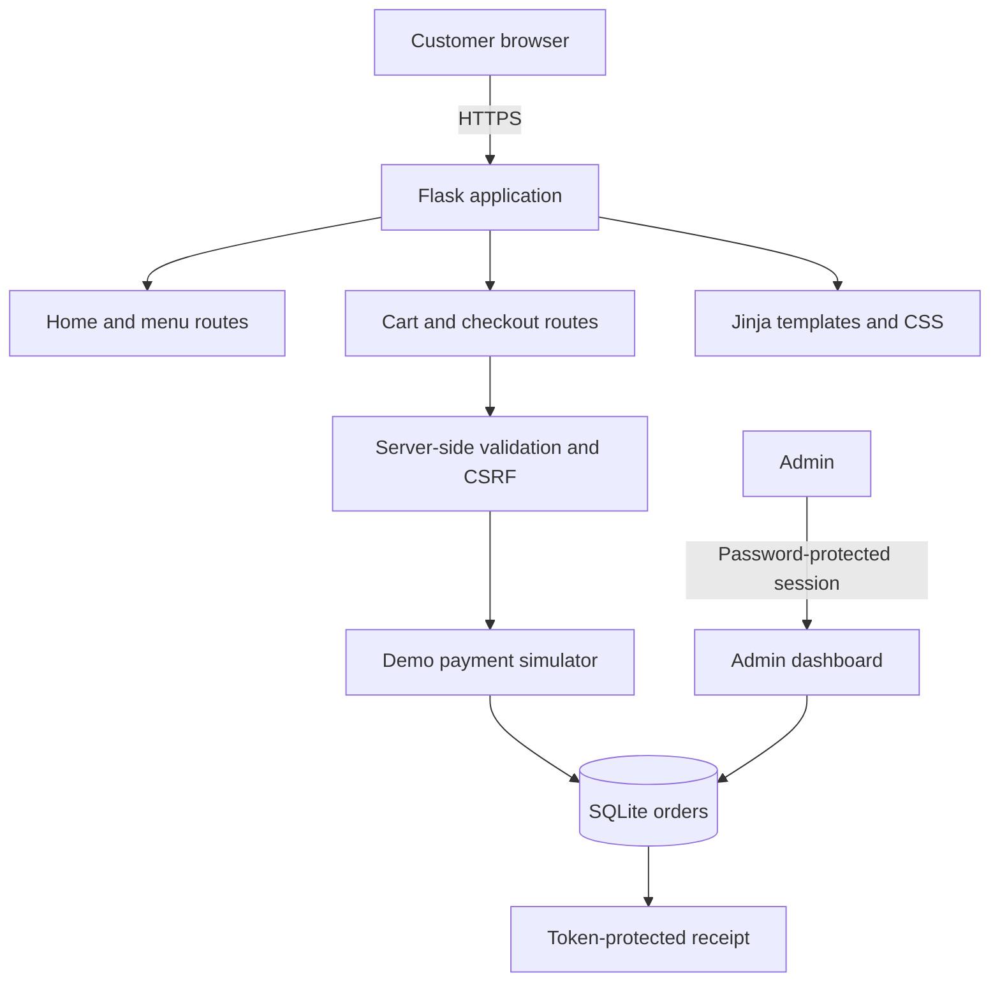

# HomeEats — Homestyle Food Ordering Demo

A responsive full-stack food ordering application built with **Python, Flask, SQLite, Jinja, HTML and CSS**. HomeEats demonstrates the complete customer journey: browse meals, manage a cart, enter delivery details, choose a payment mode, complete a clearly simulated payment, and view or print a receipt.

<p align="center">
  <a href="https://homeeats-web-production.up.railway.app"><strong>Live demo</strong></a> ·
  <a href="https://github.com/Mannn2105/Home--eats"><strong>Source code</strong></a>
</p>

> **Payment safety:** UPI and card options are simulations only. No UPI PIN, card number, CVV, bank credentials or real payment gateway is used. Demo references are generated by the app and no money moves. Cash on Delivery is recorded as payment due on delivery.

## Live demo

**[https://homeeats-web-production.up.railway.app](https://homeeats-web-production.up.railway.app)**

Try the flow:
1. Open Explore Menu and add a meal to the cart.
2. Update the quantity or add another item.
3. Continue to checkout and enter sample delivery details.
4. Choose UPI (Demo), Card (Demo), or Cash on Delivery.
5. Place the demo order to open a private receipt URL.
6. Review the payment mode, status, generated reference and order lines. Use **Print receipt** to save or print it.

Use fictional contact details when testing the public demo.

## Features

- Responsive landing page, menu catalogue, category filters and keyword search.
- Session-based cart with quantity updates and server-side price calculation.
- Checkout form with input validation and CSRF protection.
- Three payment modes: simulated UPI, simulated card, and Cash on Delivery.
- Clear payment status and unique demo transaction/reference ID.
- Private receipt link using a high-entropy random token; printable receipt layout.
- SQLite order persistence, including item-level order snapshot and payment metadata.
- Optional password-protected admin dashboard with payment details.
- Railway deployment with a persistent volume for the SQLite database.
- Automated tests and GitHub Actions CI.

## Payment demo behaviour

| Selected mode | Receipt status | Reference format |
|---|---|---|
| UPI (Demo) | Demo payment successful — no money moved | `DEMO-UPI-…` |
| Card (Demo) | Demo payment successful — no money moved | `DEMO-CARD-…` |
| Cash on Delivery | Payment due on delivery | `COD-…` |

The simulated modes intentionally do not ask for payment credentials or contact a payment processor. This is suitable for a portfolio walkthrough, not for collecting real payments. A real launch would require a provider such as Razorpay or Cashfree, server-side payment order creation, signature/webhook verification, refunds and compliance review.

## Tech stack

- **Backend:** Python 3.10+, Flask, Gunicorn
- **Database:** SQLite
- **Frontend:** Jinja templates, HTML5, CSS3
- **Quality:** unittest, GitHub Actions
- **Hosting:** Railway with persistent volume

## Architecture



The server calculates prices from the menu catalogue; browser-submitted totals are never trusted. A checkout creates an order snapshot and a random receipt token. The receipt endpoint checks both the order ID and token before showing customer information.

## Database schema

The `orders` table stores one row per completed demo checkout.

| Column | Purpose |
|---|---|
| `id` | Auto-increment order number |
| `customer`, `phone`, `address` | Delivery details |
| `items` | Human-readable item summary |
| `items_json` | Item name, quantity, unit price and subtotal snapshot |
| `total` | Server-calculated order total in INR |
| `payment_method` | UPI (Demo), Card (Demo), or Cash on Delivery |
| `payment_status` | Simulated success or due-on-delivery status |
| `transaction_id` | Generated demo/COD reference; not a processor transaction |
| `receipt_token` | Random token protecting the receipt URL |
| `created_at` | Order timestamp |

On startup, the app creates the table and adds new payment columns to an existing database without deleting earlier orders.

## Run locally

```bash
git clone https://github.com/Mannn2105/Home--eats.git
cd Home--eats
python -m venv .venv
```

Windows PowerShell:
```powershell
.venv\Scripts\Activate.ps1
```

macOS / Linux:
```bash
source .venv/bin/activate
```

Install and run:
```bash
pip install -r requirements.txt
python app.py
```

Open http://127.0.0.1:5000. The SQLite database is created at `data/homeeats.db`. Set `DATA_DIR` to change the database directory.

## Run tests

```bash
python -m unittest discover -s tests -v
```

Tests cover page rendering, menu search, cart updates, CSRF rejection, validation, UPI/card demo receipts, Cash on Delivery, receipt-token access control and the disabled-by-default admin route.

## Production deployment

The live demo runs on Railway with Gunicorn. The database directory is mounted to a persistent volume at `/app/data`, so saved demo orders survive redeployments. Configure a strong `SECRET_KEY`, `COOKIE_SECURE=1`, and a persistent `DATA_DIR` in production. The admin dashboard stays disabled unless `ADMIN_PASSWORD` is configured.

## Project structure

```text
Home--eats/
├── app.py
├── requirements.txt
├── tests/
│   └── test_app.py
├── docs/
│   ├── architecture.md
│   └── database-schema.md
├── static/
│   └── style.css
└── templates/
    ├── base.html
    ├── index.html
    ├── menu.html
    ├── cart.html
    ├── checkout.html
    ├── receipt.html
    ├── success.html
    ├── admin_login.html
    └── admin.html
```

## Limitations and next steps

This is an educational portfolio project. It does not process real payments, provide customer accounts, send delivery notifications, or integrate restaurant inventory. For a real service, integrate a payment provider, verify callbacks server-side, add authentication/rate limiting, define privacy and retention policies, and consider migrating to PostgreSQL.

## Author

Built by [@Mannn2105](https://github.com/Mannn2105).
