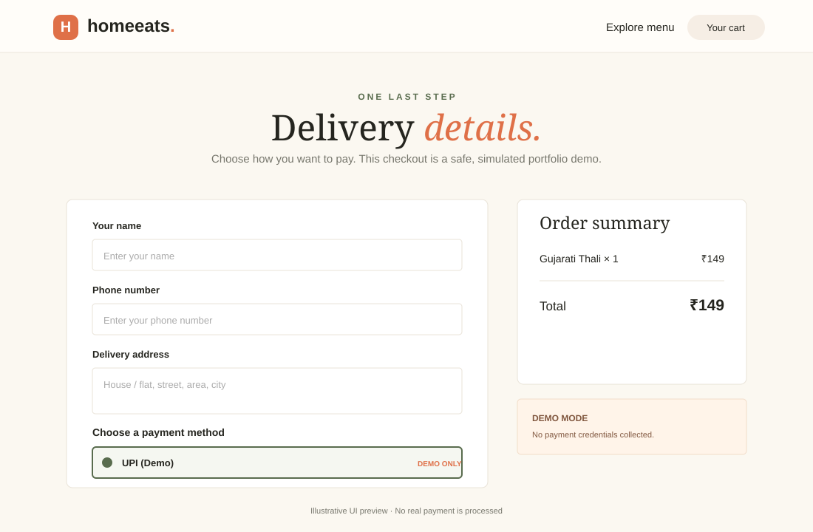
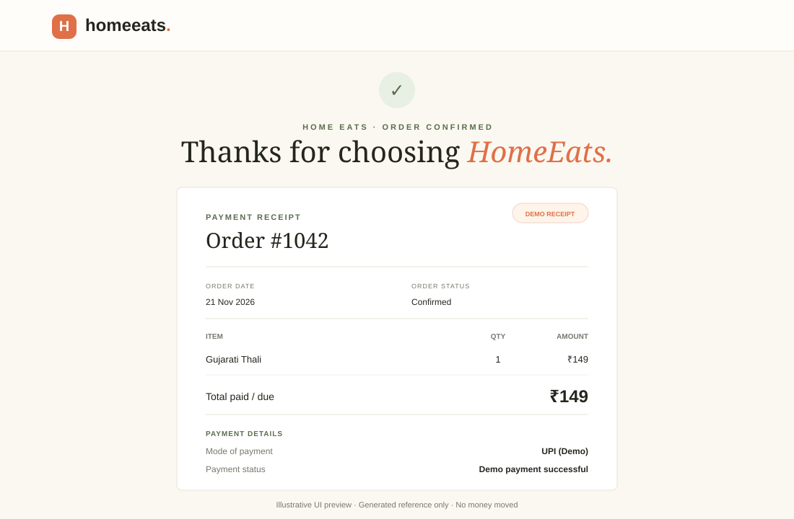
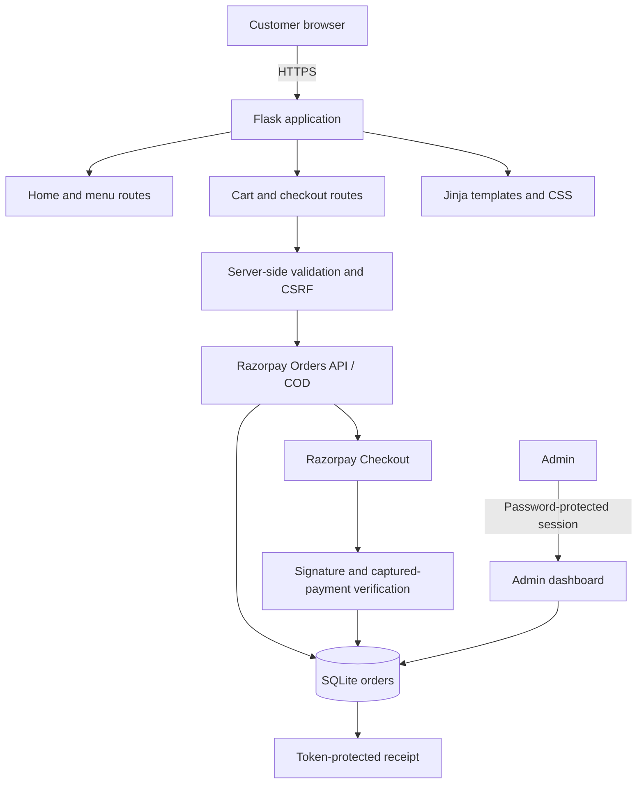

# HomeEats — Homestyle Food Ordering Demo


A responsive full-stack food ordering application built with **Python, Flask, SQLite, Jinja, HTML and CSS**. HomeEats demonstrates the complete customer journey: browse meals, manage a cart, enter delivery details, pay through Razorpay Checkout in Test Mode or choose Cash on Delivery, and view or print a receipt.

<p align="center">
  <a href="https://homeeats-web-production.up.railway.app"><strong>Live demo</strong></a> ·
  <a href="https://github.com/Mannn2105/Home--eats"><strong>Source code</strong></a>
</p>

> **Payment safety:** Online payments are currently configured for Razorpay Test Mode. Use Razorpay's test payment credentials only; test transactions do not move real money. The app never collects or stores card numbers, CVV or UPI PIN. Cash on Delivery remains available.

## UI previews

These vector previews illustrate the checkout and receipt screens in the live application.

<p align="center">
  
  
</p>

## Live demo

**[https://homeeats-web-production.up.railway.app](https://homeeats-web-production.up.railway.app)**

Try the flow:
1. Open Explore Menu and add a meal to the cart.
2. Update the quantity or add another item.
3. Continue to checkout and enter sample delivery details.
4. Choose Pay Online (Razorpay Test Mode) or Cash on Delivery.
5. Complete the Razorpay test checkout or place a COD order.
6. Review the payment mode, verified status, transaction reference and order lines. Use **Print receipt** to save or print it.

Use fictional contact details when testing the public demo.

## Features

- Responsive landing page, menu catalogue, category filters and keyword search.
- Session-based cart with quantity updates and server-side price calculation.
- Checkout form with input validation and CSRF protection.
- Razorpay Checkout for UPI, cards and netbanking in Test Mode, plus Cash on Delivery.
- Server-created Razorpay orders and server-side payment signature, amount, currency and capture-status verification.
- Payment status and gateway transaction reference on token-protected receipts.
- Private receipt link using a high-entropy random token; printable receipt layout.
- SQLite order persistence, including item-level order snapshot and payment metadata.
- Optional password-protected admin dashboard with payment details.
- Railway deployment with a persistent volume for the SQLite database.
- Automated tests and GitHub Actions CI.

## Payment integration

| Selected mode | Receipt status | Reference |
|---|---|---|
| Razorpay Test Mode | Paid only after signature and captured-payment checks pass | Razorpay payment ID |
| Cash on Delivery | Payment due on delivery | `COD-…` |

The Flask server creates the Razorpay order using the server-calculated cart total. Razorpay Checkout handles sensitive payment details. The server verifies the checkout signature, then fetches the payment and checks its order ID, amount, INR currency and captured status before marking the local order as paid. The cart is cleared only after successful verification.

### Required environment variables

Set these in Railway (or your local environment), using a matching pair generated from the Razorpay Dashboard's **Test Mode → Account & Settings → API Keys**:

- `RAZORPAY_KEY_ID` — public Test Mode Key ID.
- `RAZORPAY_KEY_SECRET` — private matching Test Mode Key Secret. Never commit it or paste it into chat.

If the keys are absent, online checkout is disabled and customers can still choose Cash on Delivery. Keep Test Mode enabled while testing. Switch to Live Mode only after a separate production-readiness review, live credentials, webhook signature verification, refund handling, monitoring and compliance review. This project currently verifies the synchronous Checkout callback; a signed webhook receiver is still recommended before a real commercial launch.

## Tech stack

- **Backend:** Python 3.10+, Flask, Gunicorn
- **Database:** SQLite
- **Frontend:** Jinja templates, HTML5, CSS3
- **Quality:** unittest, GitHub Actions
- **Hosting:** Railway with persistent volume

## Architecture



The server calculates prices from the menu catalogue; browser-submitted totals are never trusted. A checkout creates an order snapshot and a random receipt token. Razorpay payments remain pending until the server verifies the callback signature and confirms a captured payment. The receipt endpoint checks both the order ID and token before showing customer information.

## Database schema

The `orders` table stores one row per completed demo checkout.

| Column | Purpose |
|---|---|
| `id` | Auto-increment order number |
| `customer`, `phone`, `address` | Delivery details |
| `items` | Human-readable item summary |
| `items_json` | Item name, quantity, unit price and subtotal snapshot |
| `total` | Server-calculated order total in INR |
| `payment_method` | Razorpay Checkout or Cash on Delivery |
| `payment_status` | Verified captured payment, pending payment, or due-on-delivery status |
| `transaction_id` | Razorpay payment ID or generated COD reference |
| `gateway_order_id`, `gateway_payment_id` | Razorpay order and payment identifiers |
| `receipt_token` | Random token protecting the receipt URL |
| `created_at` | Order timestamp |

On startup, the app creates the table and adds new payment columns to an existing database without deleting earlier orders.

## Run locally

```bash
git clone https://github.com/Mannn2105/Home--eats.git
cd Home--eats
python -m venv .venv
```

Windows PowerShell:
```powershell
.venv\Scripts\Activate.ps1
```

macOS / Linux:
```bash
source .venv/bin/activate
```

Install and run:
```bash
pip install -r requirements.txt
python app.py
```

Open http://127.0.0.1:5000. The SQLite database is created at `data/homeeats.db`. Set `DATA_DIR` to change the database directory.

## Run tests

```bash
python -m unittest discover -s tests -v
```

Tests cover page rendering, menu search, cart updates, CSRF rejection, validation, mocked Razorpay order creation and payment verification, Cash on Delivery, receipt-token access control and the disabled-by-default admin route.

## Production deployment

The live demo runs on Railway with Gunicorn. The database directory is mounted to a persistent volume at `/app/data`, so saved demo orders survive redeployments. Configure a strong `SECRET_KEY`, `COOKIE_SECURE=1`, and a persistent `DATA_DIR` in production. The admin dashboard stays disabled unless `ADMIN_PASSWORD` is configured.

## Project structure

```text
Home--eats/
├── app.py
├── requirements.txt
├── tests/
│   └── test_app.py
├── docs/
│   ├── architecture.md
│   └── database-schema.md
├── static/
│   └── style.css
└── templates/
    ├── base.html
    ├── index.html
    ├── menu.html
    ├── cart.html
    ├── checkout.html
    ├── receipt.html
    ├── success.html
    ├── admin_login.html
    └── admin.html
```

## Limitations and next steps

This is an educational portfolio project. It does not process real payments, provide customer accounts, send delivery notifications, or integrate restaurant inventory. For a real service, integrate a payment provider, verify callbacks server-side, add authentication/rate limiting, define privacy and retention policies, and consider migrating to PostgreSQL.

## Author

Built by [@Mannn2105](https://github.com/Mannn2105).
