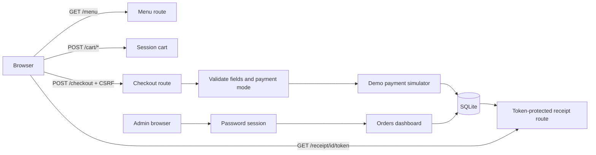

# HomeEats Architecture

## Request flow

1. A customer browses the menu and adds products to a server-side session cart.
2. The cart is recalculated from the server-owned menu catalogue. Submitted browser prices are not accepted.
3. Checkout validates delivery fields and the selected payment mode, with CSRF protection on every POST.
4. UPI Demo and Card Demo generate a clearly labelled simulated success status and demo reference. Cash on Delivery generates a due-on-delivery status and COD reference.
5. The application stores an order snapshot, payment metadata and an unguessable receipt token in SQLite.
6. The customer is redirected to a receipt URL containing the order ID and token. Both are checked before customer/order details are rendered.
7. The optional admin dashboard lists order and payment metadata after password authentication.

## Component diagram

## Trust boundaries

- The browser is untrusted. Prices, totals, order IDs and payment statuses are determined by the server.
- No payment credentials are requested or stored.
- Demo transaction references are internal display values, not bank/payment-provider references.
- Receipt access requires a random token in addition to the sequential order ID.
- POST routes require a session-bound CSRF token.
- SQLite is stored under `DATA_DIR`; production must mount persistent storage there.
